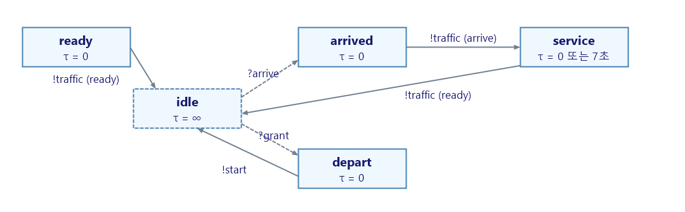
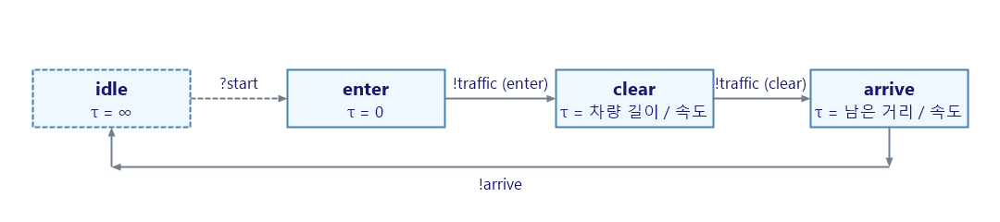

# AGV 상태천이도

입력 포트는 `?`, 출력 포트는 `!`로 시작한다. 점선 화살표는 입력에 의한 천이, 실선 화살표는 출력과 함께 일어나는 천이다. 점선 테두리는 passive, 실선 테두리는 active 상태다.

## ControlPoint

초기 차량이 있는 점은 `ready`, 다른 점은 `idle`로 시작한다. 출발 허가를 기다리는 동안 제어점은 `idle`이고 대기 차량은 제어기의 `waiting`에 남는다.

## PathSegment

초기 상태는 `idle`이다. `!traffic (clear)`는 후미가 출발점을 통과했음을 보고한다. 제어기는 출발점과 이전 세그먼트의 점유를 해제한다.

## 내부 결합

`i`는 출발점, `j`는 다음 제어점이다.

| 송신 | 수신 |
|---|---|
| Controller `!<i>` | ControlPoint i `?grant` |
| ControlPoint i `!start` | PathSegment i `?start` |
| PathSegment i `!arrive` | ControlPoint j `?arrive` |
| ControlPoint i `!traffic` | Controller `?traffic` |
| PathSegment i `!traffic` | Controller `?traffic` |
